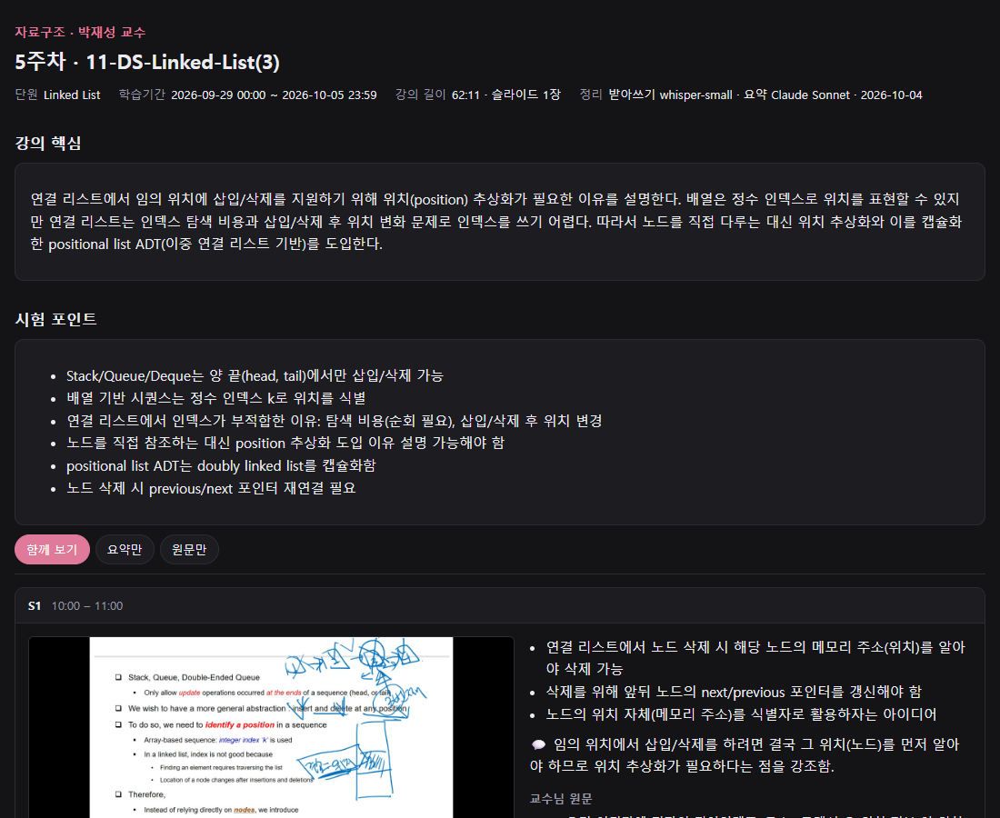
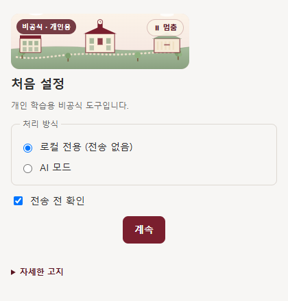
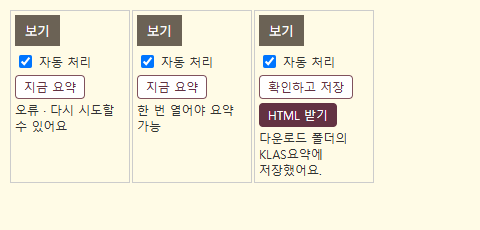
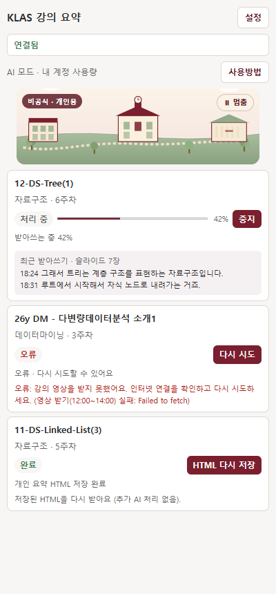
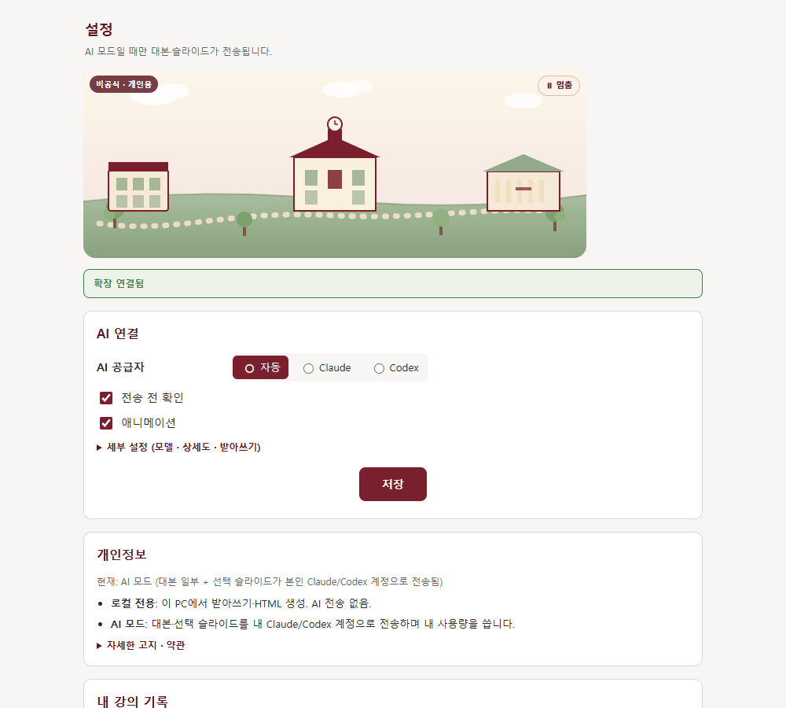

# klasnote (클라스노트)

광운대 KLAS 온라인 강의를 **Groq에서 받아쓰고**, 슬라이드와 함께 **복습용 HTML 한 파일**로 정리해 주는 Chrome 확장입니다. 음성 인식은 PC가 아니라 Groq 서버에서 하므로 노트북에 부담이 거의 없습니다(실측: 처리 중 Chrome CPU 평균 약 2%).
원하면 내 Claude Code 또는 Codex 계정으로 요약·시험 포인트까지 붙여 줍니다(요약용 API 키는 필요 없음). 받아쓰기에는 본인의 Groq Free 계정 API 키가 필요합니다.

> 비공식 개인 학습용 도구입니다. 출석·진도·인증에는 손대지 않습니다.
> 설치·사용 전에 **[사용 금지 사항](#9-사용-금지-사항-꼭-읽어-주세요)** 을 꼭 읽어 주세요. 사용하면 이에 동의한 것으로 봅니다.

### [⬇ 설치 파일 받기 — klasnote-0.1.4.zip (Windows · Mac 공용)](downloads/klasnote-0.1.4.zip?raw=true)



---

## 1. 준비물

| 필요한 것 | 설명 |
|---|---|
| **Google Chrome** | 최신 버전 |
| **Node.js LTS (18 이상)** | [nodejs.org](https://nodejs.org/)에서 **LTS** 버전 설치 (설치 프로그램과 연결 프로그램에 씀). 18보다 낮으면 설치 프로그램이 멈추고 안내해요. |
| **Groq Free 계정 API 키** | [발급 페이지](https://console.groq.com/keys). 무료 한도 내에서 사용하며 개발자 공용 키는 제공하지 않습니다. 발급 방법은 [3-2](#3-2-groq-키-넣기)를 보세요. |
| (선택) **Claude Code** 또는 **Codex** | AI 요약을 쓰려면 PC에 설치하고 로그인해 두세요. 없어도 받아쓰기·슬라이드 정리는 됩니다. 기본 모델 Opus 5.5는 **Claude Code 2.1.280 이상**이 필요해요(`claude update`). |

**Node.js가 설치됐는지 확인하는 법**: Windows는 시작 메뉴에서 `cmd`(명령 프롬프트), Mac은 `터미널`을 열고 `node -v`를 입력합니다. `v20.11.1`처럼 18 이상 숫자가 나오면 됩니다. "인식할 수 없는 명령" 같은 말이 나오면 Node.js를 설치하고 **창을 닫았다가 다시 열어** 확인하세요.

## 2. 설치하고 Chrome에 등록하기

**Google에 업로드하거나 Chrome 웹스토어에 등록하지 않아도 사용할 수 있어요.** ZIP을 받은 사용자가 자기 PC에 설치하고, 평소 쓰는 Chrome에 확장을 한 번 등록하면 됩니다. 이 등록은 개발자 도구(F12)가 아니라 **확장 프로그램 관리 페이지(`chrome://extensions`)** 에서 합니다. KLAS 로그인은 그대로 사용해요.

> 🤖 **AI 도우미(Claude Code, Codex 등)에게 설치를 맡기려면** 이 저장소의 [`INSTALL-AI.md`](INSTALL-AI.md)를 읽고 따라 하라고 하세요. 환경 점검, 진단 명령, 오류별 해결, AI가 하면 안 되는 일(키 다루기 등)이 정리돼 있어요.

전체 순서: **① Chrome·Node.js 준비 → ② ZIP 압축 풀기 → ③ `install` 실행 → ④ Chrome에 `extension` 폴더 등록 → ⑤ 처음 설정과 Groq 키 저장**. ③까지만 하면 Chrome에는 아직 아무것도 생기지 않아요. ④까지 해야 확장이 보입니다.

> **Claude 데스크톱 앱, VS Code 터미널 등 다른 프로그램 안에서 설치 명령을 실행하지 마세요.** Windows 패키지 앱 안에서 실행하면 파일과 등록 정보가 그 앱 전용 가상 공간에 저장돼 Chrome이 찾지 못해요. 이 경우 설정에서 "연결 프로그램이 설치되지 않았어요"가 뜹니다. 꼭 **탐색기(Mac은 터미널)에서 직접** 실행하세요.

### Windows

1. **ZIP 압축 풀기**
   - 받은 `klasnote-0.1.4.zip`을 **마우스 오른쪽 버튼 → 모두 압축 풀기 → 압축 풀기**로 풉니다.
   - ZIP을 더블클릭해 안에 보이는 `install.cmd`를 바로 실행하면 안 돼요. 그러면 "압축을 풀지 않은 상태에서 실행했습니다"가 뜹니다.
   - ✅ 확인: 풀린 `klasnote` 폴더 안에 `install.cmd`, `extension`, `scripts`, `native-host` 폴더가 보여요.
2. **`install.cmd` 실행**
   - 풀린 폴더의 **`install.cmd`** 를 더블클릭합니다.
   - "Windows의 PC 보호" 파란 창이 뜨면 **추가 정보 → 실행**을 누르세요(서명되지 않은 파일이라 뜨는 안내예요).
   - 관리자 권한은 필요 없어요. 하는 일은 세 가지예요.
     - 확장 파일을 `%LOCALAPPDATA%\KlasSummarizer`에 복사
     - 연결 프로그램을 현재 사용자 계정에만 등록
     - 확장 폴더 경로를 클립보드에 복사하고 그 폴더를 열기
   - ✅ 확인: 검은 창에 **"설치 완료. 확장 폴더 경로를 클립보드에 복사했습니다."** 가 보이고, `extension` 폴더 탐색기 창이 열려요. 이 검은 창은 아무 키나 눌러 닫아도 됩니다.
   - ❌ 다른 문구가 나오면 [2-1 설치 문제 해결](#2-1-설치-문제-해결)을 보세요.
3. **Chrome 개발자 모드 켜기**
   - 평소 쓰는 Chrome 주소창에 `chrome://extensions` 를 입력하고 Enter.
   - 오른쪽 위 **개발자 모드** 스위치를 켭니다.
4. **확장 폴더 등록**
   - 왼쪽 위에 생긴 **압축해제된 확장 프로그램을 로드합니다**를 클릭합니다.
   - 폴더 선택 창 위쪽 주소칸을 클릭하고 **Ctrl+V**(경로가 이미 복사돼 있어요) → **Enter** → **폴더 선택**.
   - 붙여 넣을 경로: `%LOCALAPPDATA%\KlasSummarizer\extension` (보통 `C:\Users\<내 이름>\AppData\Local\KlasSummarizer\extension`)
   - 반드시 **`extension` 폴더 자체**를 고르세요. 한 단계 위 `KlasSummarizer`나 ZIP을 푼 `klasnote` 폴더를 고르면 "매니페스트 파일이 없거나 읽을 수 없습니다"가 떠요.
   - ✅ 확인: 확장 목록에 **klasnote** 카드가 생기고 스위치가 켜져 있어요. 처음 설정 탭이 자동으로 열립니다.
5. **처음 설정**: [3. 처음 설정](#3-처음-설정)으로 이어서 진행합니다. 이미 열어 둔 KLAS 강의 목록 탭은 **F5로 새로고침**해야 버튼이 생겨요.

### Mac

1. 받은 ZIP을 더블클릭해 풉니다. 풀린 `klasnote` 폴더 안에 `install.command`와 `extension` 폴더가 보이면 됩니다.
2. **터미널**(응용 프로그램 → 유틸리티)을 엽니다. `sh ` (sh 다음 띄어쓰기 한 칸)를 입력한 뒤, 풀린 폴더의 **`install.command`** 파일을 터미널 창으로 끌어다 놓고 Enter를 누릅니다.
   - ✅ 확인: "설치 완료. 확장 폴더 경로를 클립보드에 복사했습니다"가 보이고 Finder 창이 열려요.
   - Node.js를 Homebrew로 설치했다면 `/opt/homebrew/bin`의 node도 자동으로 찾아요.
3. Chrome에서 `chrome://extensions` → 오른쪽 위 **개발자 모드** 켜기 → **압축해제된 확장 프로그램을 로드합니다**.
4. 폴더 선택 창에서 **Cmd+Shift+G** → 붙여넣기(**Cmd+V**) → 이동 → **선택**.
   - 경로: `~/Library/Application Support/KlasSummarizer/extension`
5. 확장 목록에서 klasnote가 켜져 있는지 확인하고, 이미 열어 둔 KLAS 강의 목록을 새로고침한 뒤 [처음 설정](#3-처음-설정)을 진행하세요.

> Mac 지원은 코드와 자동 테스트로 확인했고, **실제 Mac 기기에서는 아직 검증 전**입니다. 문제가 있으면 알려 주세요.

### 업데이트·재설치

설치 위치: Windows `%LOCALAPPDATA%\KlasSummarizer`, Mac `~/Library/Application Support/KlasSummarizer` (관리자 권한 필요 없음).

새 버전이 나오면 아래 순서로 진행하세요.
1. **진행 중인 처리가 끝날 때까지** 기다립니다.
2. 새 ZIP을 풀고 `install`을 다시 실행합니다.
3. `chrome://extensions`에서 klasnote의 **새로고침(↻)** 을 누릅니다.
4. **열려 있는 KLAS 페이지도 새로고침(F5)** 합니다. 페이지를 새로고침하지 않으면 목록 버튼이 "이 페이지를 새로고침(F5)한 뒤 다시 눌러 주세요"라고 안내해요.

같은 설치 폴더를 쓰므로 확장을 삭제하거나 다시 등록할 필요는 없고, 저장한 Groq 키도 그대로 남아요.

<details><summary>개발자 모드를 켜기 싫다면: 전용 Chrome 창 방식</summary>

`start.cmd`(Mac은 `start.command`)를 실행하면 확장이 미리 켜진 **KLAS 전용 Chrome 창**이 열려요. 대신 매번 이 파일로 열어야 하고, 그 창에서 KLAS 로그인을 한 번 따로 해야 해요.
</details>

### 2-1. 설치 문제 해결

화면에 뜬 문구로 찾아보세요. 원인을 모르겠으면 압축을 푼 폴더에서 명령 프롬프트(Mac은 터미널)를 열고 `node scripts/doctor.mjs`를 실행하세요. 설치 상태를 항목별로 ✔/✖로 보여 주고 고치는 방법을 알려 줘요(아무것도 바꾸지 않고, Groq 키 값도 읽지 않아요).

| 어디서 | 뜨는 문구 | 원인 | 해결 |
|---|---|---|---|
| 설치 창 | 압축을 풀지 않은 상태에서 실행했습니다. | ZIP 안에서 바로 실행함 | ZIP을 **모두 압축 풀기**로 푼 뒤 풀린 폴더의 `install.cmd` 실행 |
| 설치 창 | Node.js LTS가 필요합니다 | Node.js가 없거나 설치 직후 창이 갱신되지 않음 | Node.js LTS 설치 → 탐색기 창을 모두 닫고 다시 `install.cmd` 실행. 그래도 안 되면 PC 재시작 |
| 설치 창 | Node.js 18 이상이 필요합니다(현재 16.…) | Node.js가 너무 오래됨 | [nodejs.org](https://nodejs.org/)에서 LTS를 새로 설치 후 다시 실행 |
| 설치 창 | 설치 파일 누락: … 설치 ZIP을 다시 풀어주세요. | 압축 풀기가 중간에 실패했거나 백신이 파일을 지움 | ZIP을 새 폴더에 다시 풀고 실행 |
| 설치 창 | 다른 폴더가 이미 있습니다. 기존 파일을 보존하고 설치를 중단합니다. | `%LOCALAPPDATA%\KlasSummarizer`에 설치 프로그램이 만들지 않은 폴더가 있음 | 그 폴더 이름을 바꾸거나 다른 곳으로 옮긴 뒤 다시 실행 |
| 설치 창 | 다른 네이티브 호스트가 등록되어 있습니다. 기존 등록을 보존합니다. | 다른 위치에 설치한 예전 klasnote(개발용 등)가 등록돼 있음 | [아래 "예전 등록 정리"](#예전-등록-정리)대로 그 등록만 지운 뒤 다시 설치 (`uninstall.ps1`은 다른 위치 등록을 지우지 않아요) |
| 설치 창 | 지원하지 않는 설치 경로 문자 | Windows 사용자 이름이나 Node 경로에 `%` 또는 `"`가 들어 있음 | 이 경우는 지원하지 않아요. 알려 주세요 |
| Chrome | 매니페스트 파일이 없거나 읽을 수 없습니다 | `extension` 폴더가 아닌 다른 폴더를 고름 | `…\KlasSummarizer\extension` 폴더 자체를 선택 |
| 설정·패널 | 연결 프로그램이 설치되지 않았어요 | `install`을 실행하지 않았거나 다른 앱 안에서 실행함 | 탐색기에서 `install.cmd`를 직접 다시 실행 → `chrome://extensions`에서 klasnote 새로고침(↻) |
| 설정·패널 | 연결 프로그램이 이 확장을 허용하지 않아요 | 등록 정보와 확장 ID가 맞지 않음 | `install` 다시 실행 후 설치된 `extension` 폴더를 다시 로드 |
| 설정·패널 | 연결 프로그램이 실행되지 않았어요 | 설치 후 Node.js를 지우거나 다른 버전으로 바꿈 | Node.js LTS 설치 후 `install` 다시 실행(설치 때의 Node 위치를 기억해서 써요) |
| KLAS 목록 | 버튼이 안 보이거나 "이 페이지를 새로고침(F5)한 뒤 다시 눌러 주세요" | 확장을 등록·갱신하기 전에 열어 둔 페이지 | KLAS 페이지에서 F5 |

<a id="예전-등록-정리"></a>
<details><summary>예전 등록 정리 (Windows)</summary>

먼저 `reg query "HKCU\Software\Google\Chrome\NativeMessagingHosts\com.klas_summarizer.host" /ve`로 어디를 가리키는지 확인하세요. 예전 klasnote 폴더(또는 이미 없는 경로)가 맞다면, 명령 프롬프트에서 아래 명령을 실행하면 klasnote 연결 프로그램 등록만 지워요. 다른 프로그램 등록은 건드리지 않습니다. 실행 후 `install.cmd`를 다시 실행하세요.

```
reg delete "HKCU\Software\Google\Chrome\NativeMessagingHosts\com.klas_summarizer.host" /f
```
</details>

## 3. 처음 설정



| 선택 | 하는 일 | 토큰(AI 사용량) |
|---|---|---|
| **원문만** | 음성을 Groq로 보내 받아쓰기, 슬라이드와 원문 HTML은 PC에 저장 | 요약 토큰 0 · Groq 음성 한도 사용 |
| **AI 모드** | 위 내용 + 내 Claude/Codex 계정으로 요약·시험 포인트 추가 | 강의 1개당 약 4만 토큰(추정) |

### 3-1. 처리 방식 고르기

확장을 등록하면 처음 설정 탭이 자동으로 열려요. 원하는 방식을 고르고 **Groq 음성 전송 동의**에 체크한 뒤 계속을 누르면, 다음 단계인 설정 화면이 열립니다.

### 3-2. Groq 키 넣기

**키 발급**
1. [console.groq.com/keys](https://console.groq.com/keys)에 접속해 로그인합니다(처음이면 가입. Free 플랜으로 충분해요).
2. **Create API Key**를 누르고 이름(예: `klasnote`)을 넣은 뒤 만듭니다.
3. 화면에 뜬 키(`gsk_`로 시작)를 **복사 버튼으로 전체 복사**합니다. 이 화면을 닫으면 키를 다시 볼 수 없으니, 잃어버렸다면 새로 만들면 돼요.

**키 저장**
1. klasnote 설정 화면을 엽니다. 여는 방법은 세 가지예요.
   - 처음 설정에서 계속을 누르면 자동으로 열려요.
   - 키 없이 KLAS 목록에서 **지금 요약**을 누르면 설정 화면이 자동으로 열려요.
   - Chrome 오른쪽 위 퍼즐 아이콘 → klasnote → 오른쪽 패널의 **설정**. 또는 `chrome://extensions` → klasnote **세부정보** → **확장 프로그램 옵션**.
2. 맨 위 **Groq 받아쓰기** 칸의 **API 키**에 붙여넣습니다(Ctrl+V). 입력한 글자는 가려져 보여요.
3. **강의 음성을 Groq로 보내 받아쓰는 데 동의합니다**에 체크합니다.
4. **키·동의 저장**을 누릅니다. 저장 직후 연결 확인까지 자동으로 해요(음성 한도는 쓰지 않아요).
   - ✅ **"저장 완료 · Groq 연결 성공"** 이 보이면 끝. KLAS 강의 목록에서 **지금 요약**을 누르면 됩니다.
   - ❌ 오류 문구가 보이면 아래 표를 보세요.

| 뜨는 문구 | 해결 |
|---|---|
| 키를 저장했습니다. 받아쓰기를 하려면 "…동의합니다"에 체크하고 다시 저장하세요. | 동의 칸에 체크하고 **키·동의 저장**을 다시 누르세요. 키는 다시 넣지 않아도 돼요. |
| API 키를 입력하세요. | 키 칸이 비어 있어요. 복사한 키를 붙여넣으세요. |
| Groq API 키를 설정하거나 다시 확인하세요. | 키가 틀렸거나 일부만 복사됐어요. 발급 페이지에서 새 키를 만들어 전체를 복사하세요. 앞뒤 공백은 자동으로 지워요. |
| Groq 계정에서 선택한 전사 모델을 사용할 수 없습니다. | 계정에서 `whisper-large-v3-turbo`를 쓸 수 없는 상태예요. Groq 콘솔의 계정·조직 설정을 확인하세요. |
| Groq 사용 한도에 도달했습니다. | 무료 한도를 다 썼어요. 안내된 시간이 지나면 자동으로 이어서 처리해요. |
| Groq에 연결하거나 응답을 읽을 수 없습니다. | 인터넷 연결을 확인하고 **연결 테스트·대기 재개**를 누르세요. |
| 연결 프로그램 확인 필요: 연결 프로그램이 … | [2-1 설치 문제 해결](#2-1-설치-문제-해결)의 "설정·패널" 줄을 보세요. |

키는 설치된 연결 프로그램 옆의 사용자 설정 파일에 저장되고, Chrome 저장소·HTML·배포 ZIP에는 포함되지 않습니다. 로컬 음성 모델은 사용하지 않습니다. 유료 플랜 키를 넣으면 비용이 생길 수 있으므로 무료 사용을 원하면 계정의 Free 플랜을 확인하세요.

현재 Groq 공개 무료 기본 한도는 `whisper-large-v3-turbo` 음성 **2시간/시간, 8시간/일**, 20요청/분입니다. 조직 단위이며 [계정별 실제 한도](https://console.groq.com/settings/limits)가 우선합니다. [공식 한도 문서](https://console.groq.com/docs/rate-limits). 429 한도 초과는 서버의 재시도 시각까지 현재 강의와 대기열을 유지합니다. 인증·서비스 연결 오류는 설정에서 연결 테스트 후 재개합니다. 강의 자체의 오류·사용자 중지는 다음 대기 강의로 넘어갑니다.

처리 방식:
- 약 2분 단위의 압축 음성(AAC)을 재인코딩 없이 M4A로 묶어 보내요. PC에서 음성 인식 모델을 돌리지 않아요.
- 구간 경계에서 말이 잘리지 않도록 **10초씩 겹쳐 보내고**, 이미 저장한 문장이 끝난 지점부터 다음 구간을 시작해요. 같은 문장이 두 번 저장되지 않아요.
- **숫자가 들어간 문장은 앞뒤를 붙여 한 번 더 받아쓰고**, 숫자가 다르게 나오면 HTML에 표시해요(구간당 최대 3문장, 분당 요청 한도 안에서 간격을 둠).
- 슬라이드는 2초 간격 키프레임에서 화면이 바뀐 곳만 저장하고, 한 장씩 처리해 메모리를 바로 돌려줘요.
- 다운로드·슬라이드 처리는 PC에서 하지만 가볍습니다(실측: 55분 강의 받아쓰기 약 6~7분, 처리 중 Chrome CPU 평균 약 2%).
- 숫자 재확인과 구간 겹침 때문에 Groq 음성 한도는 강의 길이보다 조금 더 써요(숫자가 많은 강의는 최대 30~40%).

**전송 전 확인**을 켜 두면 AI로 보내기 전에 예상 사용량을 보여 주고 물어봅니다(기본 켜짐).

## 4. 강의 정리하기

KLAS **온라인 강의 목록**의 각 강의 `보기` 버튼 아래에 클라스노트 버튼이 생깁니다.



| 버튼 | 설명 |
|---|---|
| **자동 처리** 스위치 | 켜 둔 강의는 `보기`로 열 때 자동으로 받아쓰기를 시작해요. 기본은 꺼짐이라, 원치 않는 강의에 토큰이 쓰이지 않아요. |
| **지금 요약** | 이 강의의 받아쓰기를 바로 시작해요. 별도 화면 없이 목록에 진행 상황이 표시돼요. (KLAS 진도가 있는 강의, 즉 한 번이라도 들은 강의만 눌려요) |
| **확인하고 저장** | 받아쓰기가 끝난 강의. 선택한 강의만 보낼 내용·예상 사용량을 확인한 뒤 요약 노트 HTML을 만들어요. 받아쓰기 완료만으로 AI 호출이나 노트 저장이 시작되지 않아요. |
| **HTML 받기** | 받아쓰기가 끝났으면 **요약 없이도** 원문·슬라이드 HTML을 바로 받아요. AI 요약이 실패한 강의도 받을 수 있고, AI를 부르지 않아 토큰 0. |

- 처리는 강의 재생과 **따로** 진행돼요. 배속으로 보거나 강의 창을 닫아도, Chrome이 켜져 있으면 처리는 이어져요.
- 화면 위쪽의 **"클라스노트 · 처리 중"** 표시를 누르면 진행 패널이 열려요. 표시가 거슬리면 **끌어서 옮길 수 있어요**(위치 기억).
- 결과 파일은 **다운로드 폴더 → `KLAS요약/<과목>/<주차>_<강의명>.html`** 에 저장돼요. 더블클릭하면 열리고, 인쇄하면 PDF로 저장할 수 있어요.

**결과 HTML 읽는 법**
- <mark>노란 표시</mark>: AI가 슬라이드·문맥을 근거로 고친 말. 마우스를 올리면 원래 받아쓴 말과 근거 슬라이드가 보여요. 교정은 해당 문장 안에서만 적용돼요.
- 물결 밑줄: **확인 필요**. 음성인식이 지어냈을 수 있는 말(무음에서 생기는 "감사합니다." 같은 문구, 말한 시간에 비해 글자가 너무 많은 문장, 반복)이나 **숫자 재확인 결과가 다른 문장**이에요. 지우지 않고 표시만 하니, 특히 시험에 나올 숫자는 강의로 확인하세요.

## 5. 진행 상황 보기 (오른쪽 패널)



- **처리 중**: 진행률과 **방금 받아쓴 문장**이 1~2분마다 갱신돼요. 녹음이 잘 되고 있는지 여기서 확인하세요.
- **오류**: 이유가 쉬운 말로 나오고, **다시 시도**를 누르면 멈춘 지점부터 이어서 처리해요.
- **받아쓰기 완료**: 요약 전에도 **HTML 받기**로 원문을 받을 수 있어요.
- **완료**: **HTML 다시 저장**으로 언제든 다시 받을 수 있어요.
- "저장된 받아쓰기가 없어요"가 뜨면(다른 Chrome 프로필에서 처리했거나 기록이 지워진 경우) **지금 요약**으로 다시 받아쓰면 돼요.

## 6. 설정



- **AI 공급자**: 자동 / Claude / Codex. **Codex 모델**도 고를 수 있어요(기본 GPT-6-Sol, 목록은 내 PC의 Codex 기준). ChatGPT 계정에서 안 되는 모델을 고르면 요약할 때 안내가 떠요(사용량 차감 없음).
- **세부 설정**: Claude 모델(기본 Opus 5.5, Claude Code 2.1.280 이상 필요), Codex 모델(기본 GPT-6-Sol, GPT-5.6-Sol도 PC 목록에 있으면 선택 가능), 요약 상세도(절약·표준·상세)
- 요약 모델은 PC가 아니라 Anthropic·OpenAI 서버에서 돌아요. 큰 모델을 골라도 PC 부담은 거의 같고, 계정 사용량과 응답 시간만 달라져요.
- Groq 받아쓰기는 강의를 순서대로 처리해요. 다른 강의의 **다시 시도**는 현재 강의를 중단하지 않고 대기열 뒤에 들어가요. 현재 강의를 중지하면 다음 대기 강의로 넘어가고, 로컬 음성 모델은 로드하지 않아요.
- **자동 감지**: Claude/Codex 설치 여부만 확인(토큰 0). **연결 테스트**는 실제 AI를 1번 불러요(약 2천 토큰).

## 7. 자주 묻는 질문

**Q. 매번 뭔가 실행해야 하나요?**
아니요. 평소 Chrome에 한 번 등록하면 끝이에요. 처리는 Chrome이 켜져 있는 동안 진행돼요. (전용 창 방식을 쓰는 경우에만 매번 `start`로 열어요)

**Q. 왜 웹스토어처럼 클릭 한 번으로 안 깔리나요?**
현재 ZIP 배포 방식에서는 처음 한 번 "개발자 모드 → 압축해제된 확장 프로그램 로드"가 필요해요. 이는 Google에 파일을 올리는 절차가 아니라 내 Chrome에 로컬 폴더를 등록하는 절차입니다. [Chrome 공식 로컬 확장 설치 안내](https://developer.chrome.com/docs/extensions/get-started/tutorial/hello-world#load-unpacked)를 참고하세요. Chrome이 가끔 개발자 모드 확장 안내를 띄울 수 있어요.

웹스토어 공개는 개발자가 선택할 수 있는 별도의 배포 방식이며, ZIP으로 사용하는 데 필수는 아니에요. AI 요약은 PC의 Claude/Codex CLI와 연결 프로그램을 사용하므로, 웹스토어에 공개하더라도 이 로컬 프로그램의 설치가 별도로 필요합니다.

**Q. 설정의 "자동 감지"에서 Claude/Codex가 안 나와요.**
`install`을 탐색기(Finder)에서 직접 다시 실행해 주세요. 다른 앱 안에서 실행했다면 Chrome이 AI 연결 프로그램을 찾지 못해요.

**Q. 토큰이 많이 드나요?**
받아쓰기는 Groq 무료 한도를 쓰고 AI 토큰은 0이에요. AI 요약만 사용량이 들고, 발화마다 번호를 붙여 보내므로 이전보다 조금 늘었고, 1시간 강의 기준 입력 약 4만·출력 약 5천 토큰은 이전 최소 옵션 기준 추정이에요. 현재는 CLI 기본 지침과 개인 규칙을 함께 읽으므로 실제 사용량은 더 클 수 있어요. 같은 강의를 다시 받을 땐 0이에요.

**Q. 내 Codex·Claude 요약 규칙을 따르나요?**
요약은 각 CLI가 읽는 전역 개인 지침을 따릅니다. Codex는 `CODEX_HOME`의 `AGENTS.md`/`AGENTS.override.md`와 사용자 설정, Claude는 `~/.claude/CLAUDE.md`와 사용자 규칙·설정(사용자 지정 설정 폴더 포함)을 정상 로드합니다. 문체·언어·분량·상세도는 개인 지침을 우선하며, 앱이 문장 수나 요약 항목 수를 잘라내지 않습니다. HTML용 JSON 구조와 응답 크기·교정 표시의 기술적 제한은 유지합니다.

실행은 새 임시 폴더에서 하므로 현재 개발 프로젝트에만 둔 규칙은 포함하지 않습니다. 파일·명령 실행 도구와 MCP는 기존처럼 차단하고, Claude 자동 훅도 이 요약 실행에서는 끕니다. CLI에 로드되는 지침이며 모델의 준수 자체를 보증하는 강제 검증기는 아닙니다. [Codex 공식 지침 안내](https://learn.chatgpt.com/docs/agent-configuration/agents-md), [Claude 공식 지침 안내](https://code.claude.com/docs/en/memory).

**Q. 요약과 시험 포인트는 어떤 기준으로 만드나요?**
슬라이드마다 요약을 붙이지 않고, 강의 전체에서 교수님이 중요하다고 말한 내용과 반복 강조·상세 설명한 개념을 주제별로 모읍니다. 시험 포인트는 `[시험 언급]`, `[중요 강조]`, `[복습 추천]`을 구분하고 근거 슬라이드 번호·시간 범위를 붙입니다. 단순히 오래 설명한 내용을 시험에 나온다고 단정하지 않습니다. 문체·분량·상세도는 개인 규칙을 따르며, 슬라이드 이미지와 받아쓰기 원문은 그대로 볼 수 있습니다.

이전 방식으로 저장된 요약은 새 요약노트를 만들 때 재생성 안내와 예상 사용량을 보여 줍니다. 확인 버튼을 눌러야 AI를 호출하며, 새 방식으로 만든 요약은 이후 추가 호출 없이 다시 받을 수 있습니다. 이미 다운로드한 HTML은 자동으로 바뀌지 않습니다.

**Q. "오류"가 떴어요.**
패널을 열어 이유를 확인하고 **다시 시도**를 누르세요. 인터넷이 잠깐 끊긴 경우, 강의를 동시에 재생해서 영상 해석이 실패한 경우는 대부분 다시 시도로 해결돼요. 요약 오류여도 받아쓰기는 남아 있어 **HTML 받기**는 계속 돼요.

**Q. "Claude Code가 오래되어 선택한 모델을 쓸 수 없습니다"가 떠요.**
터미널에서 `claude update`를 실행한 뒤 **다시 시도**를 누르세요. 저장된 받아쓰기로 요약만 다시 만들어요.

**Q. "페이지를 새로고침(F5)한 뒤 다시 눌러 주세요"가 떠요.**
확장을 새로 설치하거나 새로고침하면, 이미 열려 있던 KLAS 페이지의 버튼은 연결이 끊겨요. KLAS 페이지를 F5로 새로고침하면 돼요.

**Q. 노트북이 느려지거나 망가지지 않나요?**
음성 인식은 Groq 서버에서 하므로 PC의 GPU를 쓰지 않아요. 실측으로 처리 중 Chrome CPU는 평균 약 2%였고, 슬라이드 처리 중 GPU 메모리가 순간적으로 커지던 문제도 고쳤어요.

**Q. 출석에 영향이 있나요?**
없어요. 플레이어를 조작하지 않고 영상 파일만 따로 읽어요. 출석은 평소처럼 KLAS에서 강의를 들어야 인정돼요.

## 8. 제거
- Chrome: `chrome://extensions`에서 klasnote **삭제**
- Windows: 폴더의 `uninstall.ps1`을 오른쪽 클릭 → PowerShell에서 실행
- Mac: 터미널에서 `sh uninstall.command`
- 브라우저에 남은 강의 기록은 먼저 **설정 → 로컬 기록 → 기록 삭제**로 지우세요. 이미 받은 HTML 파일은 남아요.

## 9. 사용 금지 사항 (꼭 읽어 주세요)

강의 영상·슬라이드·교수님 발언은 **교수자와 학교의 저작물**이고, 강의에는 다른 학생의 목소리·이름 같은 **개인정보**가 섞일 수 있어요. 이 도구는 **본인이 수강 중인 강의를 본인만 복습**하는 용도로만 쓸 수 있어요. 아래 행위는 하지 마세요.

**결과물 공유·배포 금지**
- 만든 HTML·대본·슬라이드 이미지·요약을 다른 사람에게 보내기, 단톡방·커뮤니티·SNS·블로그·자료 공유 사이트·클라우드 공유 링크에 올리기
- 결과물이나 이 도구를 이용한 정리본을 판매하거나 대가를 받고 제공하기 등 **영리 목적 이용**
- 결과물을 편집해 자기 저작물처럼 공개하기

**강의 영상 자체 보관·유출 금지**
- 이 도구나 그 코드를 고쳐 강의 영상·음성 파일을 통째로 저장·보관·배포하기 (도구는 영상을 저장하지 않고 받아쓰기·슬라이드 캡처만 PC에 남겨요)
- 여러 강의를 한꺼번에 받도록 고치는 등 학교 서버에 과도한 부하를 주는 사용

**계정·학사 관련 금지**
- 다른 사람의 KLAS 계정으로 쓰거나, 내 계정을 남에게 빌려주거나, 수강하지 않는 강의에 쓰기
- 교수자가 녹음·녹취·받아쓰기(전사)를 금지한 수업에서 사용하기
- 출석·진도·학습 시간을 속이거나, 강의를 듣지 않고 들은 것처럼 보이게 하려는 목적의 사용 (출석은 KLAS에서 직접 들어야 인정돼요)
- 시험·과제·퀴즈의 부정행위 (요약 결과를 과제로 그대로 제출하기, 시험 중 사용 등) — 수업별 AI 이용 규정이 있으면 그 규정을 따르세요. AI 사용을 금지한 수업에서는 AI 모드를 쓰지 마세요.

**제3자 권리·약관**
- 강의에 나온 다른 학생의 이름·목소리·발언을 따로 정리해 공유하기
- AI 모드는 내 Claude·Codex 계정의 이용약관을 따라요. 계정 공유 등 약관 위반 사용 금지

**도구 재배포**
- 이 도구를 고쳐 다시 배포할 때 이 금지 사항을 빼거나, 출석 조작·영상 저장·대량 수집 같은 기능을 넣기

**책임 한계**
- 이 도구는 학교와 무관한 **비공식** 도구이며, 결과의 정확성이나 학교 규정 적합성을 보증하지 않아요. 사용 책임은 사용자에게 있어요.
- 학교·교수자가 사용 중단을 요청하면 즉시 사용을 멈추고 저장한 결과물을 지워 주세요.
- 이 안내는 법률 자문이 아니에요. 애매하면 학교(교수자)에 먼저 확인하세요.

## 10. 개인정보 · 유의사항
- 받아쓰기·슬라이드·요약 기록은 내 PC 브라우저에 저장돼요. 음성 구간(숫자 재확인용 짧은 구간 포함)은 Groq API로 전송하며 서비스의 데이터 정책이 적용됩니다. 개발자 공유 서버·공동 캐시는 없어요.
- AI 모드에서는 대본과 일부 슬라이드가 **내** Claude/Codex 계정으로 전송되고 내 사용량을 써요.
- 받아쓰기·AI 요약은 틀릴 수 있어요. 원문과 슬라이드로 확인하세요. 결과 HTML은 개인 복습용으로만 쓰세요. 강의 자료의 저작권은 교수님께 있어요.
- 학교의 AI 이용 허가는 받지 않았어요.

## 11. 검증 상태 (v0.1.4, 2026-10-05)
- 자동 테스트 112개 통과: Groq 연결·한도·키 보호·중지·대기열, 구간 겹침, 발화 단위 교정, 확인 필요 표시, 숫자 재확인, 요약 없는 HTML 받기 등.
- Windows 실제 사용(Core Ultra 5 225H, 16GB): 55분 강의 받아쓰기 약 6~7분, 처리 중 Chrome CPU 평균 약 2%. 슬라이드 처리 때 GPU 메모리 최대치를 약 40% 줄였어요(1.27GB → 0.76GB, 짧은 구간 비교).
- 같은 강의 음성으로 구간을 나눠 받아쓴 결과와 한 번에 받아쓴 결과를 비교해 경계에서 빠지거나 겹친 문장이 없음을 확인했어요.
- 실제 강의 요약(Opus 5.5)에서 교정 40건이 대부분 맞았어요(선형대수, 연역·귀납 추론, 전치행렬 등).
- 이전 로컬 방식에서 수강 중인 실제 강의 31개의 영상 정보·음성·화면 해석을 확인했습니다(영상 형식 2종: `screen.mp4`, `ssmovie.mp4`).
- 한계: 숫자 재확인은 같은 모델로 하므로 같은 오류를 반복하면 못 잡고, "십 퍼센트"처럼 한글로 받아쓴 숫자는 확인하지 않아요.
- 미검증: 실제 Mac 기기, 무음 직후 구간의 시간 오차가 슬라이드 정렬에 주는 영향, KLAS Helper와 강의 화면 동시 사용 전체 흐름

<details><summary>개발자용</summary>

```
npm ci
node scripts/vendor.mjs          # 처리 라이브러리를 extension/vendor로 복사
npm test                         # 테스트
node scripts/build-package.mjs   # downloads/klasnote-<버전>.zip 생성
```
화면 예시 이미지는 예시 데이터로 실제 확장 화면을 캡처한 것입니다.
</details>
